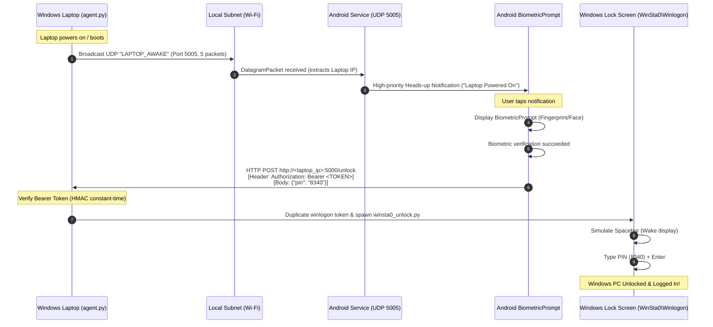

# Remote Laptop Biometric Unlock (Android + Windows)
**Made by specxy.net • Licensed to specxy.net**

A complete, production-ready, local-network system that enables an Android smartphone to automatically detect when a Windows laptop boots, alert you with a high-priority heads-up notification, and instantly unlock your Windows PC upon a successful fingerprint scan.

---

## License & Attribution
- **Author & Maintainer**: [specxy.net](https://specxy.net)
- **License**: MIT License (specxy.net)
- Full license terms are available in [`LICENSE`](file:///d:/Users/Project/LockUnlock/LICENSE).

---

## What is the Secret Bearer Token? Do I need to modify it?

### 1. What is it?
The **Secret Bearer Token** is a pre-shared passphrase that acts as a secure "digital handshake" between your Android phone and your Windows laptop:
- Because both devices are on your local Wi-Fi, anyone else connected to your Wi-Fi router could potentially send commands to port 5000.
- The Bearer Token prevents unauthorized users from locking or unlocking your laptop.
- Whenever your phone sends an `/unlock` or `/lock` request, it includes this token in the header (`Authorization: Bearer <TOKEN>`). The Windows agent checks this token before accepting any command.

### 2. Do I need to modify it?
**No, you do NOT need to modify it!**
- The project comes with a secure default token:
  `change_this_to_a_secure_token_123456`
- This token is already pre-configured in both `windows_agent\.env` and the Android app (`RemoteLaptopUnlock.apk`).
- It works straight out of the box without any modification!
- **Important**: If you ever decide to customize the token, you must enter the exact same token in both `windows_agent\.env` and in the Android app's **Secret Bearer Token** field.

---

## How Does It Bypass the Windows Hello PIN Screen?

When your laptop locks or boots up, Windows isolates the login screen on a special high-security desktop called `WinSta0\Winlogon`:
1. Normal user background processes cannot type into the Windows Hello screen due to Windows User Interface Privilege Isolation (UIPI).
2. The **specxy.net Windows Agent** solves this:
   - When running as an elevated boot service, it duplicates the security token of `winlogon.exe` (running in Session 1).
   - It launches an internal helper (`winsta0_unlock.py`) directly inside the `WinSta0\Winlogon` desktop.
   - The helper wakes the screen, sends a Spacebar to dismiss the lock screen curtain, clears any stray characters, types your configured PIN (`8340`), and submits with Enter.
   - Your laptop unlocks and logs in without you needing to touch the keyboard!

---

## 1-Click Agent Restarter / Upgrade

If you ever need to apply updates, restart the background agent, or re-register the boot task:
1. Right-click or double-click **`restart_agent.bat`** in the project root (or `install_boot_service.bat` in `windows_agent`).
2. Click **Yes** on the Windows UAC elevation prompt.
3. The script will automatically:
   - Terminate any old background agent processes.
   - Register the elevated Windows Boot Task (`RemoteLaptopUnlockBoot`).
   - Start the agent and verify the `/ping` health check.

---

## Architecture & System Workflow



---

## Project Structure

```
d:\Users\Project\LockUnlock\
├── LICENSE                            # MIT License (specxy.net)
├── restart_agent.bat                  # 1-Click Elevated Agent Restarter / Boot Task Installer
├── quick_start.bat                    # Central Interactive Control Center
├── RemoteLaptopUnlock.apk             # Pre-compiled, ready-to-install Android APK (specxy.net)
├── README.md                          # Comprehensive setup & operational guide
├── windows_agent/                     # Windows Background Service
│   ├── agent.py                       # Flask server + UDP broadcaster + Winlogon token unlock
│   ├── winsta0_unlock.py              # Winlogon desktop keystroke injector
│   ├── requirements.txt               # Python package dependencies
│   ├── .env.example                   # Configuration template
│   ├── .env                           # Active configuration file (PIN: 8340)
│   ├── register_boot_task.ps1         # Elevated PowerShell task scheduler script
│   ├── install_boot_service.bat       # 1-Click Boot Task installer
│   ├── uninstall_boot_service.bat     # 1-Click Boot Task uninstaller
│   ├── setup_windows.bat              # One-click Windows setup wizard
│   ├── start_agent.bat                # Launch agent in console mode (visible logs)
│   ├── start_silent.bat               # Launch agent silently in background
│   ├── stop_agent.bat                 # Stop background agent processes
│   ├── setup_firewall.ps1             # PowerShell script to open ports 5000 & 5005
│   └── test_agent.py                  # Self-diagnostic test script
└── android_app/                       # Android Studio Project (Kotlin)
    ├── RemoteLaptopUnlock.apk         # Compiled debug APK (ready to install)
    ├── build_apk.bat                  # One-click build script
    ├── install_apk.bat                # One-click ADB install script
    ├── local.properties               # Android SDK pointer
    ├── build.gradle.kts               # Root Gradle build script
    └── app/
        ├── build.gradle.kts           # App-level dependencies (Biometrics, OkHttp, Coroutines)
        └── src/main/
            ├── AndroidManifest.xml    # Permissions, service type, cleartext traffic
            ├── res/                   # Layouts, vector drawables, themes, network config
            └── java/com/remoteunlock/app/
                ├── MainActivity.kt            # UI, BiometricPrompt, OkHttp HTTP calls
                ├── LaptopDiscoveryService.kt  # UDP 5005 Coroutine listener + MulticastLock
                ├── ApiClient.kt              # OkHttp client for unlock/lock/ping
                └── PreferenceHelper.kt       # Persistent settings storage (Default: 192.168.1.2)
```

---

## Quick Setup Guide

### Step 1: Start or Restart the Windows Boot Agent
1. Double-click **`restart_agent.bat`** (or `windows_agent\install_boot_service.bat`).
2. Click **Yes** when Windows prompts for Administrator permissions.
3. The script will register the boot task and start the agent automatically.
4. You will see:
   ```
   [OK] Agent is active and responding!
   Status  : online
   Author  : specxy.net
   License : specxy.net
   ```

### Step 2: Install the App on Your Android Phone
1. Transfer **`RemoteLaptopUnlock.apk`** from `d:\Users\Project\LockUnlock\RemoteLaptopUnlock.apk` to your phone.
2. Tap the APK on your phone and select **Install** (Allow installation from unknown sources if prompted).
3. Open the **Remote Laptop Unlock** app.
4. When opened, the app is pre-configured with:
   - **Laptop IP**: `192.168.1.2`
   - **HTTP Port**: `5000`
   - **Secret Bearer Token**: `change_this_to_a_secure_token_123456`
   - **Windows Hello PIN**: `8340`
5. Tap **Ping Agent** to verify connection. The status bar will turn blue: `Agent is ONLINE!`.
6. Enable the **Background UDP Listener (Port 5005)** toggle to receive boot notifications!

---

## How to Test

### Test 1: Remote Workstation Lock
1. In the Android app, tap **Lock Laptop**.
2. Your laptop workstation locks immediately (`WinSta0` / `LockWorkStation`).

### Test 2: Remote Biometric Unlock (Windows Hello PIN Bypass)
1. Laptop is at the Windows Hello PIN lock screen (`8340`).
2. In the Android app, tap **Unlock Laptop (Biometric)**.
3. Scan your fingerprint on the phone sensor.
4. The phone sends the authenticated request to the laptop.
5. The laptop display wakes up, dismisses the curtain, types the PIN `8340`, and unlocks Windows into your desktop!

### Test 3: Boot Detection (Cold Boot)
1. Turn off or restart your laptop.
2. Keep the Android app's background listener enabled.
3. When the laptop boots up, it automatically starts `agent.py` before login and broadcasts the UDP beacon.
4. Your Android phone catches the beacon and shows a high-priority heads-up notification:
   > **Laptop Powered On — Tap to unlock**
5. Tap the notification, touch your fingerprint sensor, and your laptop unlocks!
